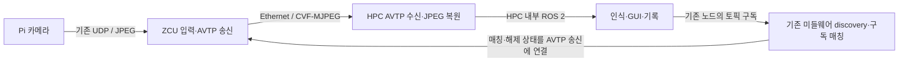

# 카메라 AVTP 전송 계약 v1

작성: 2026-09-11. 상태: **재검토 중 / 구현·실기 검증 전**.
[요구사항 대조 검토](camera-avtp-contract-review-2026-09-11.md)의 미해결 항목은
확정 요구사항으로 사용하지 않는다. 사용자 후속 지시: 기존 30~33 Hz 영상 주기 유지·추가 고정 대기 없음,
동기화 상실 시 영상 유지·시간 측정 무효화. 기존 frame ID는 AVTP로 동등하게 대체할 수
있을 때 제거한다. 비동기 재조립과 원본 추적 ID 보존 방식은 기술 검토 중이다.
구독 설계 수정: 기존 미들웨어의 discovery·구독 매칭·연결 상태 관리를 재사용한다.
별도 애플리케이션 구독 갱신 프로토콜은 도입하지 않는다. AutoSDV 내부 계약이다. IEEE 인증 또는 현재
장비의 AVTP 지원을 확인했다는 의미가 아니다. 이 문서에서 “필수”는 구현 요구사항이다.

## 1. 범위와 고정 결정

- Pi→ZCU의 UDP/JPEG 입력은 유지한다. ZCU→HPC 이미지 본문만 Ethernet L2 AVTP로 전환한다.
- 구독 여부와 연결 수명은 기존 미들웨어 기능으로 관리한다. 서비스·수신 상태도 기존 미들웨어로 전달한다.
- 별도 프레임 메타데이터 메시지는 필수 요구사항이 아니다. 원본 추적 ID 대체 가능 여부는 §8을 따른다.
- 구독 중 기존 30~33 Hz 영상 주기를 유지한다. 전송 속도를 무제한으로 높이거나 별도의 고정 출력 지연을 추가하지 않는다.
  기존 주기 제어에 별도 프레임 타이머를 중복 추가하지 않는다.
- 기존 노드 실행·GUI 노드 시작으로 구독하는 사용 방식을 유지한다. 별도 수요 등록이나 구독 관리자 프로토콜을 추가하지 않는다.
- HPC 목적지 MAC에 유니캐스트한다. 동적 AVDECC/ACMP, SRP, 멀티캐스트는 v1 범위 밖이다.
- JPEG를 재인코딩하지 않고 CVF/MJPEG로 매핑한다. H.264·RVF·독자 JPEG 페이로드를 자동 대안으로 사용하지 않는다.
- 이미지 전송 설정 `middleware|avtp`는 기존 미들웨어 선택과 독립적이다.
  AVTP 모드에서 이미지 본문을 미들웨어로 중복 송신하거나 장애 시 자동 전환하지 않는다.
- HPC 내부 ROS 2 이미지 전달은 허용한다. 차량 네트워크(IVN)로 이미지가 다시 나가지 않도록 제한한다.



## 2. 기존 코드와 연결점

| 위치 | 확인한 현재 동작 | 구현 시 변경 |
| --- | --- | --- |
| [ZCU camera_server.cpp](../../S32G3_ZCU/src/camera_module/camera_server.cpp) | UDP JPEG 수신 후 `ImagePublisher::publish` 호출 | 입력 검증 이후 구독 확인 및 AVTP 송신 연결 |
| [ZCU transport.hpp](../../S32G3_ZCU/include/transport/transport.hpp) | 미들웨어별 `ImagePublisher` 제공 | AVTP 송신을 미들웨어 구현과 분리, 기존 구독 매칭 상태를 송신 조건에 연결 |
| [ZCU zcu_health_node.cpp](../../S32G3_ZCU/src/health_module/zcu_health_node.cpp) | 이미지 publisher 발견 및 입력 활동으로 상태 판단 | AVTP 모드에서는 입력·구독·송신을 별도 판단 |
| [HPC JPEG 디코더](../src/camera_perception_pkg/camera_perception_pkg/ethernet_image_publisher_node.py) | `/image_0N_raw`의 JPEG를 디코딩해 `/image_0N` 발행 | AVTP 수신기가 기존 JPEG 입력 계약으로 연결 |
| [통신 모드 관리자](../src/launch_pkg/launch_pkg/communication_mode.py) | HPC/ZCU 미들웨어 모드 전환 | 이미지 전송 설정 검증, 전환 시 기존 구독 해제 및 재설정 |
| [Zenoh 카메라 브리지](../config/zenoh/zenoh_bridge_camera_ivn.json5) | 이미지 경로를 7447에 연결 | 이미지 본문 전달만 차단하고 필요한 discovery·구독 정보 유지; 상태는 기존 제어 경로 사용 |

이 문서 기준으로 소스만 조사했다. 실행 중인 장비·스위치 설정은 조회하거나 변경하지 않았다.

## 3. 카메라 식별과 배포 설정

| camera_id | ZCU | 기존 JPEG 토픽(HPC 내부) | 디코딩 출력 | stream unique_id |
| --- | --- | --- | --- | --- |
| image_01 | ZCU1 / 10.0.0.2 | /image_01_raw | /image_01 | 1 |
| image_02 | ZCU1 / 10.0.0.2 | /image_02_raw | /image_02 | 2 |
| image_03 | ZCU2 / 10.0.0.3 | /image_03_raw | /image_03 | 3 |
| image_04 | ZCU3 / 10.0.0.4 | /image_04_raw | /image_04 | 4 |
| image_05 | ZCU4 / 10.0.0.5 | /image_05_raw | /image_05 | 5 |

`stream_id`는 ZCU IVN MAC 48비트와 위 unique_id 16비트를 순서대로 연결한 64비트 값이다.
MAC과 stream_id는 양단 배포 설정에 고정한다. 중복 ID는 시작 오류다.
IP는 제어 경로 식별용이며 AVTP 패킷에는 들어가지 않는다.

배포 manifest의 필수 항목은 `profile=autosdv-cvf-mjpeg-v1`, `camera_id`, `zcu_id`,
`source_mac`, `destination_mac`, `stream_id`, `interface`, `vlan_mode`,
`max_avtpdu_bytes=1400`이다. tagged 구성은 `vlan_id`, `pcp`도 필수이다.
`gptp_domain`은 시간 측정 설정으로 기록하며 동기화 미확보 자체로 영상 송신을 막지 않는다.
필수 값 누락·잘못된 MAC·ID 중복 시 송신을 시작하지 않는다.
동작 중 목적지·VLAN·영상 프로파일 변경은 허용하지 않고 해제→설정→재구독한다.

HPC NIC는 기존 IVN 배선과 설정을 기준으로 확인한다. 정상 구성에서 `10.0.0.10`을
소유한 인터페이스인지 대조하되, IP가 없다는 이유로 다른 NIC를 임의로 선택하지 않는다.
저장소에 `enp4s0`와
`enP2p1s0`가 혼재하므로 이름을 복사해 고정하지 않는다. ZCU의 기본 후보는 `pfe0`이다.
실제 MAC과 VLAN ID는 **배포 시 장비에서 채울 값**이다. 임의 MAC/VLAN을 계약에 넣지 않는다.
기존 IVN 영상 경로와 큐 정책을 우선 재사용한다. VLAN 태그 사용 여부·VID·PCP는
실제 스위치의 분류/전달 설정을 대조한 후 확정한다. 기존 PCP=5/Q5 제안은 후보이며
고정 요구사항이 아니다. AVTP는 IP DSCP 분류 대상이 아니므로 tagged이면 PCP,
untagged이면 지원되는 L2 분류/PVID 정책으로 기존 영상 큐에 연결할 수 있는지 확인한다.
PCP 숫자가 자동으로 큐 번호가 된다고 가정하지 않는다.

### 3.1 확인된 값과 남은 결정 (2026-09-11 로컬 조회)

| 항목 | 확인된 사실 | 확정/검증할 내용 |
| --- | --- | --- |
| Pi JPEG 소스 | cam.py/webcam.py는 OpenCV JPEG 인코딩, 품질 80, 영상 입력 640×480 기준, payload 65,000 B 초과 시 제외 | 각 실제 입력의 JPEG marker·sampling·tables·restart·크기 분포 확인. 소스 설정을 실제 표본 결과로 간주하지 않음 |
| 영상 주기 | 사용자 지정 기존 30~33 Hz 유지. 소스의 FPS 환경변수 기본값은 30 | 실제 실행 설정·전환 전후 수신 간격 확인. 인코더나 프레임 주기를 새로 선택하지 않음 |
| HPC NIC 후보 | enP2p1s0, MAC 4c:bb:47:3a:37:97, MTU 1500, driver r8126 | 실제 IVN 배선과 일치하는지 확인한 후 사용 |
| HPC 링크 | 조회 당시 NO-CARRIER/DOWN, IPv4 주소 없음 | 링크 복구 후 기존 10.0.0.10 설정·ZCU 연결 확인. 현재 MAC은 후보 NIC의 관측값이지 배포 확정값은 아님 |
| PTP 기능 | ethtool은 hardware TX/RX timestamp와 PHC 0을 보고 | gPTP 실제 설정·동기화 상태 확인. 기능 광고만으로 동기화 성공을 주장하지 않음 |
| ZCU NIC/MAC | 저장소 IVN 기본 NIC는 pfe0 | ZCU1~4의 실제 송신 NIC·MAC·MTU·링크 속도 읽기 |
| 스위치 | 저장소 switchcore_0_Config.txt에 VLAN/PVID 관련 설정과 별도 ST/복제 실험 구성이 존재 | 실제 적용 이미지/revision, 연결 포트, VLAN·큐·gate·policing·L2 전달 규칙 확인. 실험 설정의 VLAN 102 등을 영상용으로 복사하지 않음 |

결정의 기본 방향은 기존 JPEG·해상도·품질·영상 주기·IVN NIC·MAC·배선·영상 큐를 유지하는 것이다.
실제 JPEG가 CVF/MJPEG 매핑 후보와 맞지 않으면 미지원 요소를 먼저 식별한다.
Pi 인코딩 변경·재인코딩·독자 포맷으로 자동 전환하지 않는다.

스위치에서 정할 값은 (1) 영상의 VLAN 태그 여부와 VID, (2) 영상 큐 분류 방법,
(3) 해당 VLAN/목적지 MAC을 HPC 연결 포트로 전달하는 규칙이다.
MAC learning을 사용하는 기존 구성이면 이를 우선 유지하고, 정적 전달이 필요한 경우만
HPC MAC의 목적 포트를 설정한다. AVTP stream_id 설정만으로 스위치 전달이 구성된다고 가정하지 않는다.
기존 큐의 gate 개방 시간·대역폭 제한이 5개 영상 흐름을 수용하는지 확인하고,
정상 전달이 가능한 구성에 새 TSN schedule이나 복제 경로를 추가하지 않는다.

실제 JPEG 송신 표본과 ZCU/스위치의 현재 적용 상태는 아직 확보하지 못했다.
이 항목은 장비 연결 후 읽기·캡처로 확인할 기술 정보이며 사용자가 임의 숫자를 선택할 항목이 아니다.

## 4. 영상 wire profile

IEEE 1722-2016 CVF/MJPEG 공통 형식을 v1 기준으로 선택한다.
아래 대괄호의 VLAN 태그는 §3에서 tagged 구성을 선택했을 때 사용한다.
Open1722의 아래 고정 소스와 RFC 2435를 구현 참고로 사용하되, 최종 적합성은 해당 IEEE
규격 및 독립 디코더/패킷 캡처로 검증한다. Open1722의 최신 버전 전체 기능을 요구하지 않는다.

```text
Destination MAC | Source MAC | [802.1Q(0x8100, VID, PCP, DEI=0)]
| EtherType 0x22F0 | CVF header(24 B) | MJPEG header(8 B)
| 필요 시 quantization tables | JPEG scan fragment
```

| 필드 | v1 규칙 |
| --- | --- |
| subtype / version / SV | CVF `0x03` / `0` / `1` |
| format / format_subtype | RFC `0x02` / MJPEG `0x00` |
| sequence_num | 패킷마다 증가하는 uint8, 255→0 래핑; 프레임 ID로 사용 금지 |
| stream_id | §3 값 |
| TV / TU | 시각 유효성·불확실성을 표준 의미로 표시; 동기화 상실 자체로 영상 송신을 중지하지 않음. 비동기 CVF 규칙 검증 필요 |
| avtp_timestamp | 유효할 때 표준 시각 의미를 유지; 원본 frame ID 삽입 금지. 생성·수신 규칙은 §5의 기술 검토 항목 |
| M | 해당 프레임의 마지막 fragment만 1 |
| stream_data_length | CVF 헤더 뒤 MJPEG 헤더·테이블·scan fragment의 실제 바이트 수 |
| MR | media clock restart 시 표준 의미로 변경; 세션 UUID 대용으로 사용 금지 |
| PTV / EVT / reserved | MJPEG v1에서 0; 독자 메타데이터 삽입 금지 |
| AVTPDU 상한 | CVF 헤더부터 1400 B; Ethernet/VLAN 헤더·FCS 제외 |

RFC 2435 매핑에서는 JPEG scan을 운반하고 헤더를 복원한다. JPEG 파일 전체를 그대로
fragment payload에 붙이지 않는다. 영상 주기는 기존 30~33 Hz를 유지한다.
아래 JPEG 프로파일은 현재 코드의 640×480 입력을 기준으로 한 매핑 후보이며 실제 표본 검증 전이다.
Baseline sequential,
single interleaved scan, 기본 Huffman tables, 8비트 quantization을 지원한다.
MJPEG Type 0(4:2:2) 또는 1(4:2:0)을 원본에서 판별하며 Width/Height는 80/60이다.
Q=255로 각 프레임 첫 fragment에 두 quantization table을 명시한다.
Type-specific=0, restart marker 없는 입력만 허용한다.
progressive·다른 subsampling·custom Huffman·restart marker·해상도 변경은
`UNSUPPORTED_JPEG`로 보고하고 해당 프레임을 버린다. 재인코딩으로 숨기지 않는다.

Fragment offset은 JPEG scan 내 바이트 위치이다. 기본 fragment scan 상한은
`1400 - 24 - 8 = 1368 B`; 첫 fragment는 quantization header 4 B와 tables 128 B를
추가로 빼므로 1236 B이다. 다중 바이트 wire 필드는 network byte order를 따른다.

입력 JPEG 상한은 현재 Pi→ZCU UDP의 65,507 B 상한에서 실제 입력 헤더를 뺀 값이다.
6 B 헤더는 65,501 B, legacy 4 B 헤더는 65,503 B로 기존 입력 허용 범위를 유지한다.
이 제한을 넘는 영상 지원은 Pi 입력 계약 변경이 필요한 별도 작업이다.

JPEG 보존의 의미는 압축 scan·quantization을 바꾸지 않는 것이다. APP/EXIF 등
비영상 헤더를 복원 과정에서 생략할 수 있으므로 **원본 JPEG 파일 hash 일치**는 합격 기준이 아니다.
동일 디코더의 원본/복원 픽셀 일치와 scan·table 보존을 검증한다.

## 5. 기존 30~33 Hz 주기 유지와 시각

구독 중 카메라 영상은 현재처럼 30~33 Hz 주기를 유지한다(프레임 간격 약 30.3~33.3 ms).
기존 입력의 주기 제어를 유지하며 ZCU/HPC에 별도 프레임 타이머를 중복 추가하지 않는다.
이는 최대 속도 전송으로 바꾸거나 정확히 30 Hz로 제한하라는 요구가 아니다.
ZCU의 패킷화와 HPC의 재조립·디코딩은 이 입력 흐름을 따르며 추가 고정 대기를 넣지 않는다.
30~33 Hz는 영상 프레임 주기이며 한 프레임의 AVTP fragment를 30~33패킷/초로 제한하는 값이 아니다.
카메라 간 동시 표시·동시 인식 입력을 위한 프레임 정렬은 요구사항이 아니다.
고정 50 ms presentation offset, 지정 시각까지의 출력 대기 및 그 시각에 따른
10/100 ms 수신 폐기 정책은 제거한다. 실제 소요되는 패킷화·네트워크·재조립·디코딩 시간과
인위적인 출력 대기는 구분한다. 필요한 NIC 큐·트래픽 제어를 없앤다는 의미는 아니다.

시각 동기화가 정상일 때는 유효 시각을 시간 측정에 활용한다.
동기화가 끊겨도 구독·영상 전송은 유지하고, 동기화에 의존하는 호스트 간 지연 값은
무효로 표시한다. 각 호스트의 monotonic clock으로 측정하는 수신 간격·처리 경과시간은
계속 사용할 수 있다. 시각 신뢰도가 복구되면 해당 측정을 재개한다.

AVTP wire timestamp의 표준 의미와 애플리케이션의 즉시 소비 정책은 구분한다.
예약 재생용 timestamp를 임의 frame ID로 바꾸거나, 유효하지 않은 시각을 동기화된
절대 시각으로 해석하지 않는다. 동기 재생을 요구하는 외부 수신기와의 상호운용까지
이번 즉시 처리 동작으로 보장한다고 주장하지 않는다.

재조립의 필수 조건:

- source MAC·stream_id·프로파일·실제 길이를 확인한 패킷만 처리한다.
- offset 0과 필요한 테이블, 끝 fragment, 빈 구간 없는 scan을 확보한 뒤 출력한다.
- 중복은 재출력하지 않고 충돌하는 중복·잘못된 길이는 폐기한다.
- 카메라별 버퍼 수·프레임 크기·fragment 수·미완성 보관 시간에는 유한 상한을 둔다.
- 미완성 프레임을 버린 뒤 다음 정상 프레임으로 복구한다. 영상 재전송은 하지 않는다.
- 송신 대기는 현재 프레임 하나와 최신 대기 프레임 하나로 제한한다.
- 복원 완료 영상은 보관 타이머가 끝날 때까지 기다리지 않는다.

**구현 전 해결할 기술 항목:** CVF/MJPEG에서 시각이 유효하지 않을 때의 프레임 경계,
sequence wrap·손실·재정렬·송신자 재시작 처리. stream_id, packet sequence, offset,
marker를 활용하되 sequence만으로 영구적인 프레임 식별이 가능하다고 가정하지 않는다.
TV만 0으로 바꾸고 기존 timestamp 기반 재조립을 유지하는 구현은 허용하지 않는다.
표준 프로파일 검증과 패킷 시험으로 이 경로를 확정한 뒤 PoC를 진행한다.
동기화 상실 시 영상을 계속 전달한다는 요구는 기술 검증 결과에 맞춰 임의로 철회하지 않는다.

## 6. 미들웨어 구독 계약

구독의 기준은 기존 노드가 생성·해제하는 미들웨어 subscriber이다.
사용자가 HPC에서 노드를 실행하거나 GUI에서 노드를 시작하면 기존처럼 구독한다.
별도 SUBSCRIBE/RENEW/UNSUBSCRIBE 메시지, ACK, 애플리케이션 lease,
소비자 수요 등록·heartbeat, 1초 갱신·3초 구독 만료 규칙을 추가하지 않는다.

| 미들웨어에서 확인한 상태 | AVTP 송신 동작 |
| --- | --- |
| 해당 카메라의 유효한 HPC 구독이 없음 | 송신하지 않음 |
| 첫 유효 구독이 매칭됨 | 입력·네트워크 준비가 정상이면 즉시 송신 시작 |
| 여러 구독 중 일부만 해제됨 | 남은 유효 구독이 있으면 계속 송신 |
| 마지막 유효 구독이 해제되거나 미들웨어가 소멸을 통지함 | 송신 큐를 비우고 새 패킷 제출 중지 |
| 노드 재시작 후 다시 매칭됨 | 현재 상태를 확인하고 송신 재개 |

프로세스 비정상 종료·연결 단절의 판단과 검출 시간은 사용 중인 미들웨어의 기존
발견·연결 수명 설정을 따른다. 자체 주기 메시지로 같은 판단을 중복 구현하지 않는다.
정상 종료 시에도 애플리케이션 해제 요청 대신 기존 subscriber 해제 통지를 사용한다.

미들웨어 이미지 endpoint와 AVTP stream의 관계는 §3의 카메라 매핑으로 연결한다.
AVTP 모드에서는 구독을 발견하는 데 필요한 endpoint·discovery 정보를 유지하면서
미들웨어의 이미지 본문 write/put 경로를 AVTP 송신으로 바꾼다.
이미지 본문을 끄면서 discovery까지 제거해서는 안 된다.

기존 구독 지점은 `/image_0N_raw`와 `/image_0N` 사이의 디코딩 경로를 포함해 추적한다.
AVTP 수신용으로 새로 만든 상시 endpoint가 구독을 스스로 유지하는 순환을 만들지 않아야 한다.
기존 노드의 시작·종료가 구독에 미치는 동작을 먼저 보존하며, 이를 임의의
“최종 소비자 수요” 등록 방식으로 교체하지 않는다.
HPC 내부 JPEG 발행자와 ZCU의 발견용 endpoint가 서로 매칭되어 송신을 영구 유지하지
않도록 로컬 영상 전달과 원격 구독 정보의 연결 지점을 구현 전에 확인한다.

각 backend에서 실제로 노출되는 매칭·해제 정보와 bridge의 전달 방식은 구현 전
기존 코드에서 확인한다. DDS와 Zenoh/bridge가 동일한 API를 제공한다고 가정하지 않는다.
bridge 연결의 존재만으로 HPC의 카메라 구독이 있다고 판단하지 않는다.
필요한 작업은 기존 미들웨어 정보의 연결이며, 별도 구독 프로토콜 구현이 아니다.

## 7. 서비스 상태와 장애 처리

기존 서비스 발견·상태 보고 경로를 재사용한다. 기존 health 메시지에 카메라의
입력 상태, 미들웨어 구독 유무, AVTP 송신 상태, 시각 동기화 상태 및 카운터를 연결한다.
별도 주기 offer/request/reply 프로토콜을 만들지 않는다.
상태 보고 주기와 노후화 판정은 기존 health 정책을 따르며 구독 수명 판정으로 사용하지 않는다.

미들웨어 구독이 존재한다는 사실과 실제 영상 수신 성공은 구분한다.
입력이 없으면 구독을 유지하고 WAIT_INPUT을 보고한다. 입력 복구 후 송신한다.
네트워크 오류로 송신이 불가능하면 오류를 보고하고, 복구 후 현재 매칭 상태를 다시 확인한다.
시각 동기화 상실 시에는 영상 송신을 유지하고 시간 측정의 무효 상태를 보고한다.
어느 경우에도 애플리케이션이 미들웨어 구독을 인위적으로 만료시키지 않는다.

HPC 수신 경로 활성화·상대 재시작 시 미완성 재조립 상태를 초기화한다.
잔류 패킷을 새 프레임으로 오인하지 않는 방법은 §5의 재조립 검증에 포함한다.
별도 ACK, 시작 시각 협상, 구독 갱신 메시지는 추가하지 않는다.

## 8. 상태·프레임 식별·HPC 호환성

| 상태 축 | 값과 의미 |
| --- | --- |
| input_state | UNKNOWN / OK / STALE / ERROR; 유효 입력 1초 미수신 시 STALE |
| subscription_state | IDLE / ACTIVE; IDLE 자체는 장애 아님 |
| tx_state | IDLE / WAIT_INPUT / SENDING / ERROR; SENDING은 송신 성공 카운터로 판단 |
| rx_state | IDLE / WAIT_FIRST_FRAME / RECEIVING / STALE / ERROR |
| clock_state | UNKNOWN / LOCKED / UNSYNCED |

HPC는 수신 경로 활성화 이후 최초 완성 프레임까지 1초, 이후 마지막 완성 프레임으로부터
1초를 영상 수신 watchdog으로 사용한다. 이 watchdog은 영상 장애 표시용이며 구독을 만료시키지 않는다.
ACTIVE인데 RX가 STALE이면 영상 경로 장애로 표시한다. 미구독은 정상 대기이며,
별도로 관측된 카메라 입력 장애까지 정상으로 덮지 않는다.

영상 경로 오류 코드는 OK, PROFILE_MISMATCH, CLOCK_UNSYNCED,
NETWORK_NOT_READY, UNSUPPORTED_JPEG, FRAME_TOO_LARGE, TX_ERROR, RX_TIMEOUT,
MALFORMED_FRAME, DECODE_ERROR를 사용한다. 문자열 enum이며 위 목록 외 값은 UNKNOWN으로 표시한다.

사용자 지시: AVTP 포맷으로 기존 frame ID를 대체할 수 있으면 제거한다.
새 `frame_meta` 타입·토픽·UUID·cache를 필수로 추가했던 결정은 철회한다.

다만 기존 ID와 AVTP의 전송 식별은 용도가 다르다.
현재 Pi가 만든 uint16 ID는 JPEG 입력 헤더→Image.header.frame_id→DetectionArray→
LaneInfo→PathPlanningResult→MotionCommand→ZCU CAN payload로 전달된다.
이는 Pi에서 시작한 프레임과 그 처리 결과를 연결하는 원본 추적 번호이다.
AVTP stream_id는 스트림, sequence_num은 8비트 패킷 순서, timestamp는 시각,
MJPEG offset·marker는 조각 위치·끝을 나타낸다. 원본 추적 번호의 직접 대체 필드가 아니다.

영상 재조립만을 위해 별도 원본 frame ID를 운반할 필요는 없다. 그러나 AVTP 번호로
기존 Pi→CAN 추적까지 보존할 수 있다는 근거는 아직 없다. 수신 완료 횟수를 새 ID로
사용하면 송신 전후의 손실 프레임을 구분하지 못하고 Pi의 기존 번호와도 일치하지 않는다.
따라서 기존 ID와 CAN/로그 필드의 삭제는 동등한 추적 방법이 확인되기 전까지 보류한다.
표준 reserved 필드·timestamp에 원본 ID를 임의로 넣어 해결하지 않는다.

구현 전 해결할 사항은 원본 추적 기능을 유지하면서 별도 프레임 메타데이터 전송을
없앨 수 있는지이다. 송신 지점의 대응 로그 등 대안을 검토하되, 새 식별자로 변경하는
경우 기존 로그·제어 추적에 어떤 영향이 있는지 먼저 명시한다. 단순히 빈 ID나 0을
전달하는 것을 동등한 대체로 인정하지 않는다.

HPC에서는 기존 카메라 노드의 시작·종료, JPEG 디코딩과 `/image_0N` bgr8 출력을 유지한다.
가능하면 기존 카메라 노드에 AVTP 입력을 연결한다. 별도 수신 노드와 동일 raw 토픽으로의
재발행은 필수 구조가 아니며, §6의 구독 지점 및 기존 raw 토픽 로그 사용처를 확인한 후 선택한다.
출력 QoS는 기존 BEST_EFFORT/KEEP_LAST 1을 유지한다.
header.stamp의 의미는 전송 변경을 이유로 바꾸지 않는다. 기존 사용처를 확인하고,
시간 측정용 유효 시각과 ROS clock을 혼동하지 않도록 한다.

## 9. 구현·검증 순서와 합격 조건

| 순서 | 작업 | 합격 조건 |
| --- | --- | --- |
| 2-A preflight | 실제 Pi JPEG 표본, MAC/NIC/VLAN, gPTP, raw socket 및 SJA1110 전달 확인 | 입력이 §4에 매핑 가능; manifest 완성; 동기화 유무별 AVTP 동작 검증; 프레임 양단 관측 |
| 2-B 카메라 1개 PoC | JPEG parser/packetizer, AVTP TX/RX, JPEG 복원 | scan·table 보존, 동일 디코더 픽셀 일치, CVF 필드·MTU 확인 |
| 3 구독 연결 | 기존 backend 매칭·해제 정보를 AVTP 송신 조건에 연결 | 노드 시작·종료·강제 종료·재시작·복수 구독·bridge 구독 전파 시험 |
| 4 HPC 통합 | 기존 노드 시작 경로·로컬 토픽·GUI health·프레임 로그 | 기존 구독 동작 유지, 상시 endpoint의 자기 매칭 방지, 원본 추적 호환성 검증, 영상 IVN 재유출 없음 |
| 5 확장 | 5개 stream, QoS 및 혼잡 시험 | 각 stream 독립성, 제어 트래픽 공존, 지연·손실·CPU·메모리 측정 |

PoC 필수 패킷 시험: 첫/중간/마지막 fragment 손실, 순서 변경, 중복 및 충돌 중복,
잘못된 offset/length/type/table, size 한도, sequence 255→0, timestamp wrap,
clock step·동기화 상실/복구 중 영상 지속, 상대 재시작·이전 프레임 잔류,
AVTP만 단절, 미들웨어만 단절, 입력만 단절.
완성되지 않은 프레임은 출력 0건이어야 하며 각 오류 후 다음 정상 프레임을 처리해야 한다.
미들웨어가 마지막 구독 해제·소멸을 통지한 후 새 송신 제출은 한 번의 제어 루프 내
(목표 100 ms 이내) 중단한다. 단절 발생부터 미들웨어 검출까지의 시간은 별도로 측정한다.

데이터 검증은 AVTP와 미들웨어를 함께 캡처하여 제어·상태 패킷에 JPEG 본문이 없고
IVN 이미지 본문이 EtherType 0x22F0에만 있는지 확인한다. VLAN 태그/offload 영향은
스위치 mirror/TAP 캡처로 확인한다. raw socket은 필요한 CAP_NET_RAW만 부여한다.

평균 부하 추정은 `평균 JPEG scan 크기 × FPS × 8`에 fragment별 Ethernet/VLAN/AVTP,
FCS·preamble·IFG 및 제어 트래픽을 더한다. 평균만으로 큐를 설계하지 않고 최대 프레임 burst도 측정한다.
전환 전후 동일 입력으로 기존 30~33 Hz 영상 주기가 유지되는지 확인한다.
평균 FPS뿐 아니라 프레임 간격과 누락도 비교한다. 정확히 30 fps로 제한하거나 고정 출력 대기를 추가하지 않는다.
5개 동시 stream의 지연 상한·손실률
보장은 측정 후 별도 성능 기준으로 확정하며, AVTP 적용 자체를 TSN 보장으로 표시하지 않는다.

1단계 산출물은 이 계약이다. 이후 단계의 배포 값 조사·코드 구현·실기 합격은 아직 수행하지 않았다.
preflight에서 JPEG나 스위치가 계약을 지원하지 않으면 원인과 필요한 변경을 기록하고
계약 revision을 갱신한다. 독자 페이로드나 UDP fallback으로 조용히 변경하지 않는다.

## 10. 근거

- [Open1722 고정 revision](https://github.com/COVESA/Open1722/tree/dfb3e6bf27a560bd75c323d5608ab63568139d00): 2026-09-11 조사 기준. 도입 버전은 이 revision을 출발점으로 빌드·검증 후 고정한다.
- [CVF 헤더 정의](https://github.com/COVESA/Open1722/blob/dfb3e6bf27a560bd75c323d5608ab63568139d00/include/avtp/cvf/Cvf.h), [MJPEG 헤더 정의](https://github.com/COVESA/Open1722/blob/dfb3e6bf27a560bd75c323d5608ab63568139d00/include/avtp/cvf/Mjpeg.h): 필드·길이·format 값 확인.
- [CVF 예제의 지원 범위](https://github.com/COVESA/Open1722/blob/dfb3e6bf27a560bd75c323d5608ab63568139d00/examples/cvf/README.md): 예제는 H.264 전용. MJPEG 헤더 API가 전체 JPEG packetizer를 제공한다는 의미는 아니다.
- [RFC 2435](https://www.rfc-editor.org/rfc/rfc2435): JPEG scan·fragment offset·table 매핑 근거. AVTP에 RTP/UDP 헤더를 추가하라는 의미는 아니다.
- [Wireshark CVF 필드](https://www.wireshark.org/docs/dfref/c/cvf.html): packet sequence·stream ID·timestamp·marker의 구분.
- [GStreamer avtpsink](https://gstreamer.freedesktop.org/documentation/avtp/avtpsink.html): Linux AF_PACKET 및 CAP_NET_RAW 사용 참고.
- [Avnu 자동차 AVB 설명](https://avnu.org/resource/avb-for-automotive-use-whitepaper/): AVTP 외 동기화·네트워크 자원 관리의 구분.

IEEE 1722 원문 전체에 대한 적합성 검토는 아직 수행하지 않았다. 위 구현 소스와 RFC의
교차 확인은 구현 출발점이며, 독립 상호운용 시험과 표준 적합성 검토를 대체하지 않는다.
